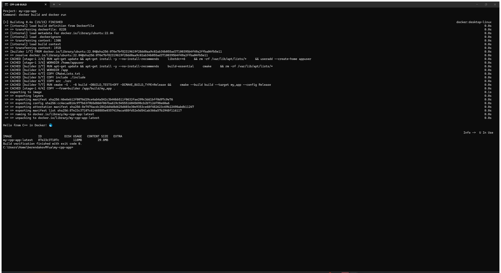
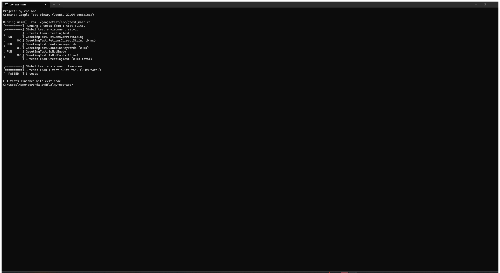
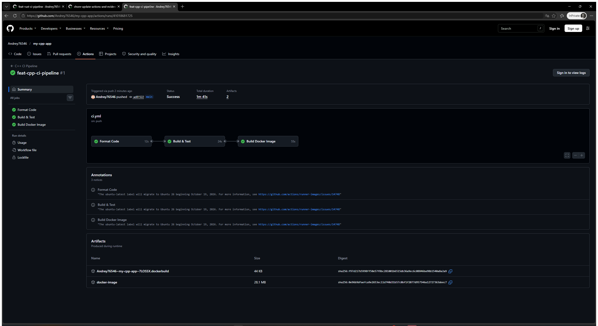

# Лабораторная работа: Pipeline CI на C++

## Цель работы

Настроить CI для C++17-проекта: форматирование clang-format, сборку CMake, модульные тесты Google Test/CTest, сборку и запуск Docker-образа и сохранение образа как артефакта GitHub Actions.

Задание выполнено по [инструкции преподавателя](https://github.com/rurewa/imfua/blob/main/content/DevOps/CI_CD/Pipelines/cpp.md).

## Использованные технологии

- C++17 и GNU C++;
- CMake и CTest;
- Google Test;
- clang-format;
- Docker и многоэтапная сборка;
- GitHub Actions.

## Описание выполненных действий

1. Создан C++17-проект с CMake.
2. Реализована функция `getGreeting()` и консольное приложение.
3. Функция вынесена в библиотеку `greeting`, поэтому тесты проверяют тот же код, который использует приложение.
4. Добавлены три Google Test: точное значение, наличие ключевых слов и непустая строка.
5. Настроены clang-format, CMake release-сборка и CTest.
6. Создан многоэтапный Dockerfile с запуском от непривилегированного пользователя.
7. В GitHub Actions настроены форматирование, сборка/тесты и Docker job с артефактом.
8. Локально проверены формат, компиляция, тесты, приложение и Docker-образ.

## Структура проекта

```text
my-cpp-app/
├── .github/workflows/ci.yml
├── include/greeting.hpp
├── screenshots/
│   ├── 01-build.png
│   ├── 02-tests.png
│   └── 03-github-actions.png
├── src/
│   ├── greeting.cpp
│   └── main.cpp
├── tests/test.cpp
├── .clang-format
├── .dockerignore
├── .gitignore
├── CMakeLists.txt
├── Dockerfile
└── README.md
```

## Команды запуска

Сборка приложения:

```bash
cmake -S . -B build -DCMAKE_BUILD_TYPE=Release -DBUILD_TESTS=OFF
cmake --build build --config Release --parallel
./build/my_app
```

Docker:

```bash
docker build -t my-cpp-app:latest .
docker run --rm my-cpp-app:latest
```

Ожидаемый вывод:

```text
Hello from C++ in Docker! 🐳
```

## Тестирование и проверка

```bash
clang-format --dry-run --Werror src/*.cpp include/*.hpp tests/*.cpp
cmake -S . -B build -DCMAKE_BUILD_TYPE=Release -DBUILD_TESTS=ON
cmake --build build --config Release --parallel
ctest --test-dir build -C Release --output-on-failure
```

Локальный результат: `100% tests passed`, 3 теста из 3; приложение и контейнер завершаются с кодом 0.

## Настройка GitHub Actions

Workflow [C++ CI Pipeline](https://github.com/Andrey76546/my-cpp-app/actions/workflows/ci.yml) запускается при push и pull request в `main`/`master`, а также вручную. Он содержит:

- `Format Code` — установка clang-format и строгая проверка всех исходников;
- `Build & Test` — установка CMake/Google Test, release-сборка, CTest и запуск приложения;
- `Build Docker Image` — Buildx, сборка и запуск образа, загрузка `docker-image.tar.gz` на 7 дней.

Все запуски: [GitHub Actions](https://github.com/Andrey76546/my-cpp-app/actions).

## Результаты выполнения

- исходники соответствуют `.clang-format`;
- библиотека, приложение и тестовый бинарник успешно компилируются;
- все 3 Google Test проходят;
- Docker-образ успешно собирается и запускается;
- CI проверяет формат, сборку, тесты и контейнер.

## Настоящие скриншоты



Снимок подтверждает успешную сборку Docker-образа, запуск приложения и наличие `my-cpp-app:latest`.



Снимок подтверждает реальный запуск Google Test: 3 теста выполнены и пройдены.



Снимок подтверждает успешное выполнение всех job workflow `C++ CI Pipeline`.

## Вывод

Создан воспроизводимый C++ CI-конвейер. CMake собирает общий код приложения и тестов, Google Test проверяет функциональность, clang-format контролирует стиль, а Docker и GitHub Actions обеспечивают переносимую сборку и автоматическую проверку каждого изменения.

